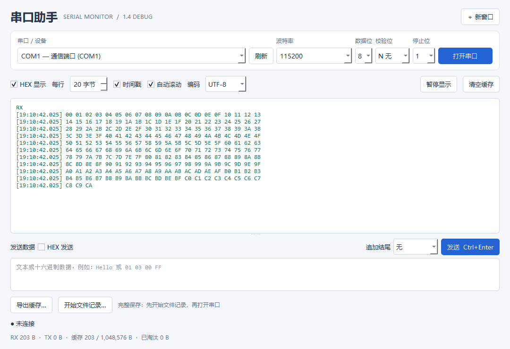

# 串口助手 | Serial Assistant

简单的 Windows 串口监视器，支持多窗口、手动波特率、端口刷新/手输、打开/关闭、文本/HEX 收发、毫秒时间戳、后台文件记录和缓存导出。

**当前版本：1.4 debug · Python 3.12 · PyQt5 · pySerial**



## 功能

- 选择或手动输入 COM 端口，自定义波特率、数据位、校验位和停止位。
- 文本/HEX 收发，支持 UTF-8、GB18030、ASCII、Latin-1。
- 正确拼接分块文本，支持 CRLF/LF/CR 换行、行首时间戳、RX/TX 方向标记。
- HEX 每行 20–90 字节可调，修改后重新排版缓存；等宽字体、RX/TX 独立标题行，数据列对齐。
- 板子重启或 USB 断开后，自动等待原 COM 端口恢复；手动关闭可以停止重连。
- 独立窗口与后台串口线程，显示缓存有上限；后台保存日志和原始字节。

## 项目结构

```text
main.py                 # PyQt5 界面和窗口交互
serial_core.py          # 串口收发、重连、后台记录与导出
display_format.py       # 文本流拼接与 HEX 排版
requirements.txt        # 固定版本运行依赖
requirements-build.txt  # 打包依赖
tests/                  # 软件回环、格式化和界面自测
tools/                  # Windows 单文件 exe 构建脚本
docs/                   # 界面截图与测试说明
```

源码启动与打包命令见下方；验证范围见 [测试说明](docs/TESTING.md)。

## 直接使用

源码可按下方步骤打包为 `dist\串口助手.exe`。已有 exe 时可以直接双击运行，不需要安装 Python；当前构建面向 Windows 10/11 x64，在 Windows 10 x64 上完成软件自测。也可重复双击 exe 多开，或点击「＋ 新窗口」。每个窗口独立连接与计数；同一 COM 端口通常只能被一个程序占用，请先关闭其他软件对该端口的连接。

1. 插上设备，点击「刷新」，选择对应 COM 号。
2. 设置波特率（默认 115200，支持手输）、数据位/校验/停止位（默认 8N1），点击「打开串口」。更改串口参数时，先关闭，再设置并重新打开。
3. 在下方输入数据，点击「发送」或按 Ctrl+Enter。HEX 发送示例：`01 03 00 00 FF`；可用空白分隔，不带 `0x` 或逗号。结尾默认「无」，可追加 CRLF/LF/CR，HEX 模式下也会追加。
4. 「HEX 显示」切换接收区表现，TX 为蓝色，RX 为绿色。连续同方向数据只在开头显示一次 RX/TX；HEX 模式把 RX/TX 放在独立标题行，数据和时间戳从下一行开始，以等宽字体对齐；文本模式在切换方向时另起一行并显示标记。时间戳仍可单独开关。清空/重建显示或显示跳过数据后，首块会重新标记方向。文件日志仍逐块保留 RX/TX，以便完整解析。「编码」作用于文本显示和文本发送，可选 UTF-8、GB18030、ASCII、Latin-1。CRLF、单独 CR 或 LF 均正常换行，跨读取块的 CRLF 只换一次；其他无法解码或不可见的控制字节用反斜杠转义显示，例如 `\xff`、`\x00`。
5. 文本显示按设备发来的真实换行排版，不会因串口分块读取而截断单词；时间戳只在每行开头显示，取该行首字节所在读取块的本机时间，精度为毫秒。勾选 HEX 显示后，可在旁边的「每行」框设定 **20–90 字节**，默认 32；每组 `00` 算一个字节（两个十六进制数字），空格、时间戳及 RX/TX 不计入。修改后会重新排版已有缓存，随后收到的数据按新值续排，分块读取不会额外断行。文本模式下此控件禁用，各窗口独立设置。文件记录和导出的原始字节不会随显示宽度改变。串口是字节流，行和读取块均不代表协议包边界。
6. 长时间收数请先点击「开始文件记录…」，选好父文件夹，再打开串口。完成后点击「停止文件记录」，等待显示「已保存」；直接关窗口也会先关闭串口并写完记录。

## 保存与显示的区别

「文件记录」在独立线程中持续保存，自动创建不重名的 `Serial_日期_时间_进程号` 子目录：

- `session.log`：UTF-8 文本，包含完整日期/毫秒时间戳、RX/TX、字节数及 HEX 数据。正常停止以 `STOP: recording closed normally` 结尾；记录异常会在界面明确提示，文件可能不完整。
- `rx.bin`：接收的原始字节，按读取顺序拼接。
- `tx.bin`：写入串口 API 成功返回的原始字节，不代表对方已收到或处理。发送超时时部分字节可能已经发出而无法准确计数。

文件记录从点击开始记录时生效，不会补录此前的数据；没有设备也可先开始记录。记录期间关闭、重新打开端口不会自动停止记录。文件每约 0.5 秒刷新一次，断电或强制结束可能丢失最后一部分数据。

「导出缓存…」只导出最近最多 **1 MiB / 8192 个数据块** 的缓存，可选带时间戳的 HEX `.log` 或仅接收的原始 `.bin`。它不等于完整记录，也不跟随文本/HEX 显示开关改变文件格式。屏幕最多保留 4000 行、约 100 万字符，缓存淘汰数量显示在底部；清空缓存不重置累计 RX/TX 计数，也不删除文件。为了避免异常长行拖慢界面，无换行的超长文本约每 4096 字符安全折行；原始记录不受影响。

「暂停显示」只暂停刷新；串口接收、计数和文件记录继续。恢复时重新显示当前缓存。GUI 忙不过来时，显示队列最多保留 1 MiB/8192 个块，跳过量会显示在底部；文件记录使用独立队列，不随屏幕丢弃。磁盘写入队列最多 32 MiB/65536 个块，满了会停止记录并提示记录不完整。以上限制只控制程序内存，不能保证设备、USB 驱动或操作系统层面永不丢数。

## 无设备自测

选择 `loop:// — 模拟回环`，打开后发送 `Hello` 或 HEX `00 01 FE FF`，应同时出现 TX 和相同内容的 RX。这个模式是软件模拟，不会连接硬件。

## 板子重启与自动重连

首次成功打开串口后，连接会一直保持到手动关闭。板子重启但串口仍存在时，不会因为暂时没数据而关闭或重开端口；如果 USB 串口消失或驱动报断线，界面显示等待设备恢复，保留原来的 COM 号、波特率和串口参数，每 0.5 秒自动重试。恢复后自动继续收数和文件记录，无需再点「打开串口」。只重连原 COM 号；如果系统分配了新的 COM 号，需要手动关闭并选择新的端口。

等待重连时发送按钮禁用，未完成的发送取消，不会在重连后自动重发旧命令。点击「关闭串口」或关窗口会停止重试。首次打开就失败（例如端口被占用）仍会报错并关闭；发送超时可能已经发出部分命令，因此也会关闭，检查后再手动打开。断电期间的设备数据无法补回。

实际验收建议：使用真实设备核对 COM 号、参数和收发；连续收数 10–30 分钟并开启文件记录；期间切换 HEX/文本、暂停/继续；再开第二个窗口连接另一个串口。把板子关掉后立即重启，或拔插 USB，检查同一 COM 号恢复后是否自动收数、记录是否继续；等待期间点击「关闭串口」，应停止自动重连。最后核对文件是否可打开、原始字节是否符合设备输出。

本版已完成软件回环、模拟输入压力和界面流程自测。**待实机验证，未同步 stable**。尚未验证具体 USB 串口驱动、设备连续采集或另一台未安装开发环境的电脑；软件自测不能替代实机验收。

## 源码 / VS Code 启动

建议 Python 3.12 x64（本次用 3.12.4 验证）。从当前文件夹运行：

```powershell
py -3.12 -m venv .venv
.\.venv\Scripts\python.exe -m pip install -r requirements.txt
.\.venv\Scripts\python.exe main.py
```

VS Code 打开整个文件夹，选择 `.venv\Scripts\python.exe` 解释器后运行 `main.py`。运行时仅需当前目录的 `main.py`、`serial_core.py`、`display_format.py` 和 `requirements.txt` 中的依赖；不依赖其他 debug 项目。

开发验证与打包：

```powershell
.\.venv\Scripts\python.exe -m pip install -r requirements-build.txt
.\.venv\Scripts\python.exe -m unittest discover -s tests -p 'test_*.py' -v
.\.venv\Scripts\python.exe tests\smoke_gui.py
powershell -ExecutionPolicy Bypass -File tools\build.ps1
```

界面测试会临时打开测试窗口，只使用软件模拟数据。构建输出 `dist\串口助手.exe`，为待验收测试程序；构建中间文件位于 debug 项目内。

程序在打开串口前将 DTR/RTS 设为关闭，当前不提供手动控制和硬件流控。部分设备驱动仍可能在打开瞬间改变电平；需要 DTR/RTS 或流控的设备尚不适用此版。
